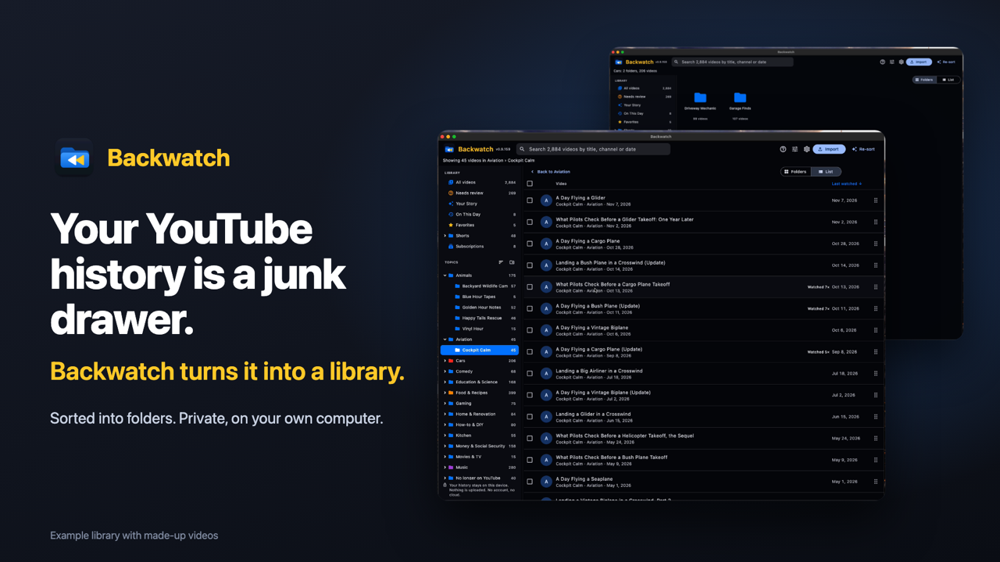
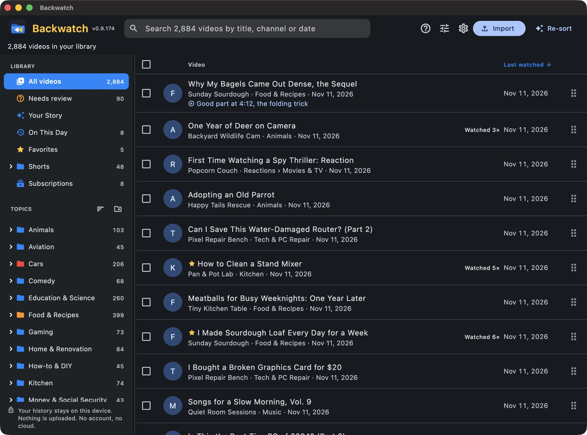
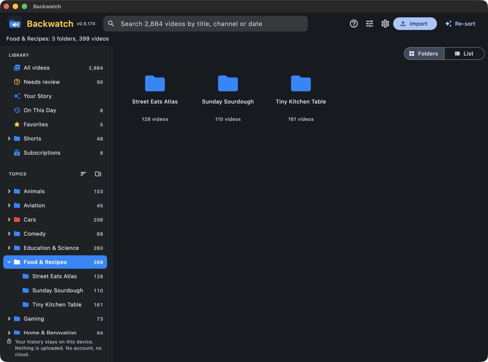
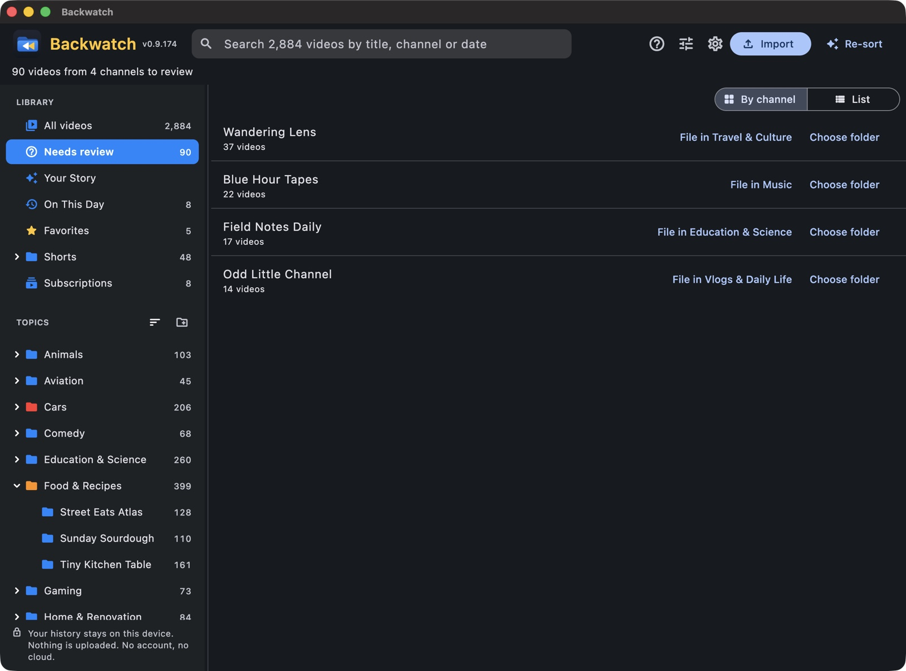
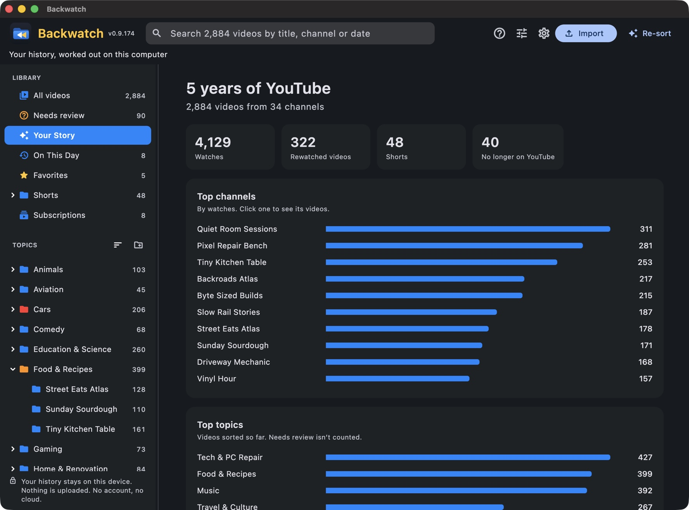

  

<h1 align="center">Backwatch™ for Mac</h1>

<b>Your YouTube watch history, finally organized.</b> 
Every video you've watched, sorted into folders on your own Mac. Private. No account. No subscription.

  
  &nbsp;
  

---

## What it does

Thousands of videos. One endless scroll. Backwatch fixes that in about a minute:

- **Every video sorted automatically** into folders by topic and channel: Tech, Music, Cars, Food & Recipes, How-to & DIY and more
- **Search everything:** titles, channels, your notes, or a date like *yesterday*
- **It learns:** file a channel once and its videos follow, now and in future imports
- **Your Story:** top channels, most rewatched, your busiest hours, year by year
- **On This Day:** what you watched on this date in past years
- **Favorites and notes** that jump straight to the moment ("good part at 4:12")
- **Backups anywhere,** even a USB stick
- **Built for big histories:** tested on 57,000+ videos

  
  

  
  

Screenshots use a made-up example library.

## How it works

1. **Download Backwatch** (button above), open it, and drag Backwatch into Applications.
2. **Get your history from Google.** Backwatch opens Google Takeout with the right boxes ticked and walks you through it.
3. **Import it.** Watch years of videos sort themselves into folders.

The download includes a **Start Here** page, a full **user guide** (PDF) and a **how-to video**.

## Private. Actually private.

Your history stays on your computer. No account, no cloud, nothing uploaded. Backwatch never asks for your Google password and never contacts YouTube by itself.

## Try it free, then unlock it

The free version shows your **newest 50 videos** with real folders and counts, so you can see what Backwatch does with your own history. Love it? [Get your serial for $14.99](https://backwatcher.gumroad.com/l/backwatch), one time, no subscription. It arrives by email and unlocks everything.

## Good to know

- **Mac:** macOS 12 or newer. Tested on Intel Macs. Apple-chip Macs aren't tested yet, so try the free version first.
- **First time you open it,** your Mac asks you to trust Backwatch (System Settings → Privacy & Security → Open Anyway), and again after each update. The Start Here page shows exactly where to click.
- Backwatch organizes the history **Google has kept for you.** If you watch without signing in, or turned history off, there may be little to import.
- Google doesn't share how long you watched, so Backwatch counts videos, never "time spent".
- **Windows:** coming soon.

## Help

Questions? **support.backwatch@gmail.com**, or in the app: Settings → About Backwatch → Contact support.

---

This repository holds Backwatch's downloads only. © 2026 Backwatch. All rights reserved. Backwatch™ is an independent app and is not affiliated with, endorsed by or sponsored by YouTube or Google.
